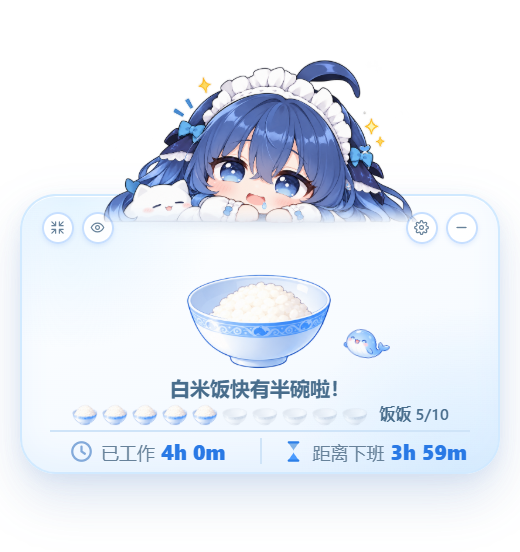
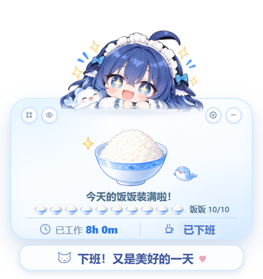
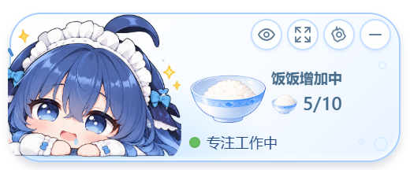
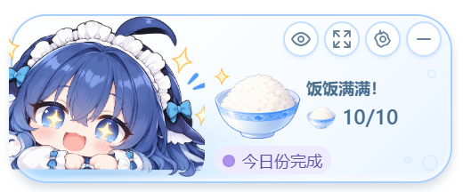

# 蓝色大肥鱼趣味积累两张角色图接入

本次只增加蓝色大肥鱼可见趣味积累模式的两个角色图片映射。没有改动进度计算、积累容器、十格标识、投放动画、文案、样式或原生窗口代码。

## 资源与来源

| 用途 | 运行素材 | 原图 |
|---|---|---|
| 5/10 期待、流口水 | `src/assets/themes/blue-whale-girl/collection/character-half.webp` | `docs/fun-accumulation/蓝发鲸尾女仆中满.png`（用户第二张图） |
| 10/10 星星眼、张嘴开心 | `src/assets/themes/blue-whale-girl/collection/character-full.webp` | `docs/fun-accumulation/蓝发鲸尾女仆（全满）.png`（用户第一张图） |

已核对源文件与本轮附件 SHA-256 完全一致，均为 1448×1086 RGBA，Alpha 范围 0～255。源文件保持原样；运行图只裁掉透明边距、等比缩放并居中对齐到原角色的 1235×561 透明画布，输出无损 WebP。没有重绘或拉伸人物，也没有覆盖原上班、午休、下班素材。

## 映射与优先级

映射位于 `src/collection/themes.ts` 的 `collectionCharacter()`：

```ts
if (id !== "blue-whale-girl") return undefined;
return stage === 5 ? characterHalf : stage === 10 ? characterFull : undefined;
```

此前角色没有半满区间映射，所以本次采用精确单点 5 和 10；4、6 及其他阶段继续使用原图。阶段文案既有的 4～6 区间保持原样，没有连带扩展角色区间。

`Widget.tsx` 和 `MiniWidget.tsx` 仅将已计算的 stage 传给 `InteractivePet.tsx`，再传给 `ChibiGirl.tsx`。没有新增计时器或重新计算阶段，也没有重构组件。

`ChibiGirl.tsx` 只在 `displayMode === "collection"`、`privacyMode === "visible"` 且角色为工作姿态时选择新图；趣味模式满格下班时，将新满格图放入原下班图片槽位。原下班状态判断、结算、文案和窗口行为完全不变。午休、休息日、上班前、隐私隐藏与实时金额模式继续使用原素材，咪宝永远不取得新映射。点击互动继续临时使用原互动素材，结束后恢复当前阶段的角色图。

## 修改清单

- 新增上述两张运行 WebP；保留并纳入本轮提交的两张用户 PNG 原图。
- `src/collection/themes.ts`：两个图片导入与精确阶段映射。
- `src/components/ChibiGirl.tsx`：在原图片槽位应用受展示方式、隐私及姿态约束的图片选择。
- `src/components/InteractivePet.tsx`、`src/components/Widget.tsx`、`src/components/MiniWidget.tsx`：仅透传已有 stage。
- `tools/verify-collection-characters.cjs`：真实 React 界面的阶段及原图优先级回归。
- 本文及 `docs/ui/collection-characters/`：对应实际界面截图。

## 检查

前端 TypeScript 和生产构建通过。专项浏览器检查覆盖两个主题、正常/迷你模式，确认仅蓝色趣味模式 5/10 与 10/10 替换；0、3、4、6、7 保持原图。额外将午休调整到阶段 5 验证睡眠图优先，检查工作/午休/下班隐私、实时金额工作/下班、休息日、十格阶段同步及原窗口尺寸。

Tauri Windows release EXE 和 NSIS 安装包构建通过。打包后 WebView2 验收通过，实际进程重启、隐私、午休与两主题业务状态正常；仅更新 `collection-desktop/blue-whale-girl-half.png`、`blue-whale-girl-full.png`、`blue-whale-girl-mini-half.png` 和 `blue-whale-girl-mini-full.png` 四张目标截图。原运行进程未被结束，退出托盘后重开即可加载新图。

| 模式 | 5/10 | 10/10 |
|---|---|---|
| 正常 |  |  |
| 迷你 |  |  |
