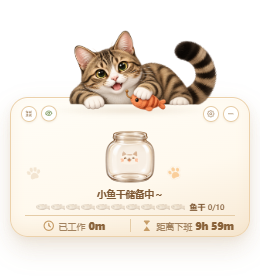
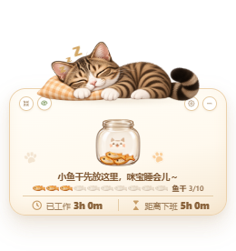

# V1.4 趣味积累与主题十格进度交付记录

本次在原项目中增量增加趣味积累展示，再追加主题十格进度和角色文案。继续使用原有角色、Tauri 窗口和工资计时机制，前端设计按照 `frontend-design` 技能复核。

## 视觉约束与布局

蓝色沿用瓷白 `#f7fbff`、白色 `#ffffff`、浅蓝 `#a9d8ff`、蓝色 `#4a9dff`、深蓝 `#2e7fe0`、文字 `#20354a`。咪宝沿用奶油 `#fff9ee`、浅焦糖 `#f7e9d4`、棕色 `#56351f`、焦糖 `#c69c67`、绿色 `#9cc45b`、边线 `#ead3b3`。继续使用项目现有 Segoe UI / Microsoft YaHei UI 字体。

主视觉是原角色与逐渐填满的美术容器；操作按钮保持原位置。十格标识放在容器与工作时间之间，迷你模式只放主题小图标和阶段数。补充施工时为十格让出原容器上方的标题行，保留主容器大小，没有增加窗口。没有新增无关的卡片、营销文案或常驻动效。

```text
完整窗口 260×276             迷你窗口 260×108
      原有桌宠              桌宠 | 原有操作按钮
操作按钮 / 主积累容器        桌宠 | 小容器 / 短文案
      当前阶段文案          桌宠 | 图标 n/10
十个主题图标 + 阶段数        桌宠 | 工作状态
已工作 / 距离下班
```

设置页保持 400×600；缩小设置页顶部头像至 104×56，为两项显示方式和说明让出空间。正常表单无滚动，保存与关闭按钮可点击；异常校验信息仍可滚动查看。

## 文件清单

| 文件 | 作用 |
|---|---|
| `src/collection/progress.ts` | 从既有工作进度取得 0～10 阶段；纯函数判断是否应播放节点 |
| `src/collection/useCollection.ts` | 记录上一次采样、控制节点反馈；可见性恢复时清除旧采样 |
| `src/collection/themes.ts` | 两套主题资源配置，只加载运行所需的图片 |
| `src/collection/copy.ts` | 全部阶段、午休、下班、休息日及节点文案 |
| `src/collection/progress.test.ts` | 阶段、边界、异常、时间跳变、主题/设置切换和文案映射测试 |
| `src/components/Collection.tsx` | 共用主容器、十格标识、迷你图标与阶段数 |
| `src/collection.css` | 容器、十格、迷你布局、700ms 动画、1s 反馈、设置控件样式 |
| `src/components/Widget.tsx` | 复用原进度与原每秒刷新；完整模式接入 |
| `src/components/MiniWidget.tsx` | 原 260×108 布局中接入容器、短文案和数量 |
| `src/components/Settings.tsx` | 显示方式草稿与保存 |
| `src/components/DisplayControls.tsx` | 趣味模式使用中性隐私工具提示 |
| `src/components/InteractivePet.tsx` | 趣味模式工作互动改为中性文案；互动时压低节点提示优先级 |
| `src/display/DisplayProvider.tsx` | 读取和同步独立的 `displayMode` 字段 |
| `src/salary/calc.ts` | 仅为既有 `workProgress` 增加非有限值保护，工资算法不变 |
| `src/main.tsx` | 导入新增样式 |
| `src-tauri/src/config.rs` | 展示方式默认值、持久化、异常配置保护和 Rust 测试 |
| `src-tauri/src/lib.rs` | 同一次保存提交工资设置和展示方式；先同步显示偏好再返回主窗口 |
| `package.json` | `npm test` 包含原工资测试和新阶段/文案测试；未增加依赖 |
| `tools/prepare-collection-assets.py` | 可重复的裁切、Alpha 清理、图层遮罩与阶段预合成 |
| `tools/verify-collection.cjs` | 浏览器功能、动画、隐私、文案和截图验收 |
| `tools/verify-collection-desktop.cjs` | 打包 Windows EXE 的原生命令、磁盘持久化、进程重启和截图 |
| `tools/verify-themes.cjs` | 测试桥接增加展示偏好字段，保存顺序与 Rust 保持一致 |
| `tools/verify-settings.cjs`、`tools/verify-work-weekdays.cjs` | 旧表单计数排除新增的 radio；更新头像尺寸预期 |
| `README.md` | 使用入口、功能介绍与真实 Windows 截图 |

## 美术检查与处理

原图保留在 `docs/fun-accumulation/`。两张 UI 意向图为 1448×1086 RGB，无 Alpha；只用于视觉参考，没有导入运行代码。两张素材集和四张新角色图均为 RGBA，实测 Alpha 范围 0～255；不能仅因扩展名为 PNG 就认定透明。角色图分别为 1254×1254 或 1448×1086，完整尺寸、Alpha 范围和有效边界见 `asset-inspection.json`。

素材集虽然透明，但透明区域中有零散杂色。脚本先按对象位置裁切，保留主要不透明连通区域及约两像素的抗锯齿边缘，去掉孤立噪点。所有源图均未修改。已有正式角色继续使用，没有替换工作、午休或下班皮肤。

蓝色饭碗由空碗、独立米饭层、前景瓷碗遮挡组合。米饭层逐段向上露出，容器保持原比例，不拉伸容器。咪宝由空罐、十个鱼干摆放位置及猫脸标签遮罩组合，鱼干裁剪在罐内。为使运行时更轻，提前合成每套主题的 11 张阶段 WebP；运行时只切换对应图片。

运行素材目录：

```text
src/assets/themes/blue-whale-girl/collection/
  bowl-empty.webp  bowl-half.webp  bowl-full.webp
  bowl-back.webp   bowl-front.webp rice-fill.webp
  rice-spoon.webp  whale.webp      star.webp
  stage-0.webp ... stage-10.webp

src/assets/themes/mibao/collection/
  jar-empty.webp  jar-full-reference.webp
  dried-fish.webp paw.webp star.webp
  stage-0.webp ... stage-10.webp
```

共 36 张无损 WebP，约 4.72 MiB；逐文件尺寸、Alpha、边界和字节数见 `runtime-assets.json`。蓝色阶段图固定 500×440，咪宝固定 500×560。独立空/半/满参考和拆分图层保留供后续维护；打包只引用实际使用的阶段、投放与装饰资源。`assets-preview.jpg` 为美术合成检查图，**不是应用截图**。

十格标识直接复用蓝色 `stage-0` / `stage-10` 和咪宝 `dried-fish`。未完成图标降低透明度及饱和度；没有为十格新增图片。迷你模式使用相同图片作为单个主题图标。

## 进度、文案和节点

`progress` 来自原 `salary/calc.ts` 的 `workProgress(now, settings)`，即有效已工作分钟 / 全天有效工作分钟；午休自动剔除。限制到 0～1 后，阶段为 `floor(progress * 10 + 1e-9)`，并限制到 0～10。微小容差只用于十等分处的浮点误差。无效或零工时得到 0，上班前和休息日明确为 0；有效工时正常时下班为 10。金额和阶段没有绑定，不受月薪高低影响。

文案配置在 `src/collection/copy.ts`，按 0、1～3、4～6、7～9、10 五组选择，再按工作状态覆盖午休、下班和休息日文案。完整/迷你使用同一个配置中的长/短版本，全部为本地静态内容。

饭勺与米饭下落、小鱼干下落均使用 700ms CSS 动画；节点反馈固定为“饭饭 +1！”或“小鱼干 +1！”，1s 后恢复阶段文案。桌宠点击互动时不叠加节点文字，原互动仍然可用。

仅在相邻两次采样间隔不超过 2.5s、同一天、相同主题/窗口/设置/隐私范围、从工作中正常增加一个阶段时播放一次。首次挂载、重启、跨阶段跳变、倒退、修改设置、主题切换或迷你切换直接同步最终阶段。文档隐藏/恢复时清除旧采样，系统减少动态效果时不投放。没有新增轮询定时器、持久化投放历史或动画依赖。下班提示条在趣味模式不重复播放原入场庆祝。

## 隐私与原功能兼容

展示方式与原隐私字段分别保存。隐私优先时完全不渲染容器、十格或阶段数量，沿用原遮盖界面；再次点击回到先前展示方式和当前真实阶段。趣味模式可见界面、DOM 和工具提示均不出现工资、人民币符号或收入统计词。工作中的问号保留，午休、下班和休息日不新增问号。

旧配置未包含 `displayMode` 时默认 `amount`。异常新字段会保留合法工资配置并进入隐藏保护。保存失败不丢失已保存偏好。设置保存时先同步展示偏好，再切回主窗口，避免展示旧模式。

窗口拖动、置顶、托盘及 DPI 放置算法没有改动；完整和迷你窗口尺寸不变。原月薪、有效工时、午休和休息日规则继续由原工资模块负责。

## 实际验证

- `npm test`：40 项通过（原工资 37，新阶段/动画判断/文案 3）。
- `cargo test --manifest-path src-tauri/Cargo.toml`：13 项通过，覆盖旧配置默认展示、展示/主题/隐私独立恢复及无效模式保护。
- `npm run build`：TypeScript 与 Vite 生产构建通过。
- `npm run tauri -- build`：Windows release EXE 与 NSIS 安装包构建通过，安装包约 29.70 MiB。
- `tools/verify-collection.cjs`：两主题、空/3/5/10、完整/迷你、十格数与主容器同步、各阶段文案、一次节点动画及恢复、午休、休息日、隐私、主题和工时修改、时间跳变、减少动态效果通过。
- `tools/verify-collection-desktop.cjs`：真实 release EXE 的 WebView2 实测通过；原生保存后磁盘字段正确，完整 260×276 / 迷你 260×108，两主题空/3/5/10、午休保持、休息日为空、隐私问号规则、桌宠互动、实际进程重启恢复展示/窗口/主题/隐私均通过。测试结束恢复原配置文件字节。
- 原有 `verify-display.cjs`、`verify-themes.cjs`、`verify-work-weekdays.cjs` 已通过；包含两套主题、四档 DPI、金额计算与隐私、设置草稿及工作日回归。
- `tools/verify-settings.cjs`：六个原工资/时间字段、金额预览、校验、保存与重开、关闭按钮命中、四档 DPI、减少动态效果和 400×600 无滚动布局通过。

浏览器验收脚本需要已有 Playwright：`node tools/verify-collection.cjs <包含 playwright 的 node_modules 绝对目录>`，并先在 127.0.0.1:5178 启动 Vite。Windows 脚本以相同参数运行，直接启动 release EXE，不依赖开发服务器。

## 真实运行截图

`docs/ui/collection-desktop/` 下全部图片来自打包后 Windows 应用的 WebView2；仅测试页面时钟受控，系统时钟没有修改。`collection-browser/` 是使用测试桥接的真实 React 界面，单独存放，未混充桌面实测。

| 场景 | 蓝色大肥鱼 | 咪宝 |
|---|---|---|
| 空容器 |  |  |
| 3/10 |  |  |
| 5/10 |  |  |
| 下班 10/10 |  |  |
| 迷你 5/10 |  |  |
| 午休 |  |  |
| 隐私隐藏 |  |  |

## 视觉与验证限制

当前是现有扁平 PNG 素材的最小分层方案：米饭沿遮罩逐段露出；鱼干复用同一条素材旋转摆放，罐体和标签来自原图。没有物理堆叠、米粒模拟或逐帧重绘的玻璃折射，满罐与美术源中的满罐参考不会逐像素相同。实际尺寸下角色、容器和十格均可辨认，未发现裁边、黑底或按钮遮挡。

睡眠恢复通过时间大幅跳变与页面可见性规则验证，没有让本机实际进入系统睡眠。没有重新测试真实多显示器拖动、托盘系统菜单或执行安装器安装；其原生代码未改，现有行为保持。安装包已成功生成，桌面实测运行的是该次构建的 release EXE。

本轮更新源码、文档和截图到现有 GitHub 仓库；未重发已存在的 v0.2.0 GitHub Release。当前产品功能称 V1.4，项目包版本仍沿用 0.2.0，避免覆盖既有发布资产。
